# Sol: Decision Trees

Each tree shows the checks in the order the code makes them, and what happens on each branch. Diamonds are checks. Rectangles are results. Companion to `FLOWS.md` (sequence diagrams) and `diagrams/mindmap.md` (overview).

Each tree names the method and state flag it uses. Scene-wired links are marked `[scene-wired]`.

## 1. Jump (Space)

Source: `PlayerController.OnJump` → `Jumping.HandleJumpInput`.

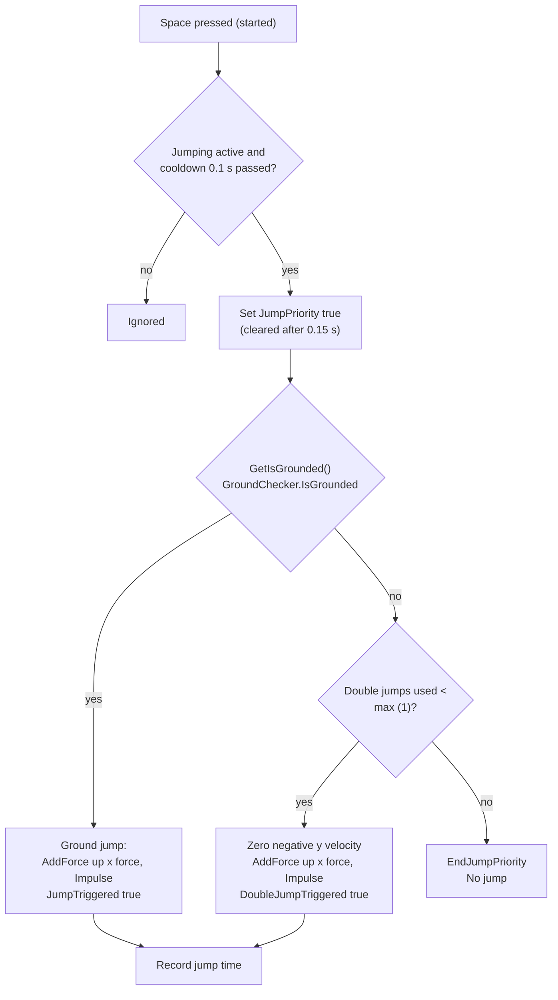

Note: `Jumping.OnCollisionEnter` resets the double-jump count when a contact normal has `y > 0.7`.

## 2. Move and run (WASD, Shift)

Source: `PlayerController.OnMove` and `OnRun`, then `Movement.Update` and `Movement.FixedUpdate`.

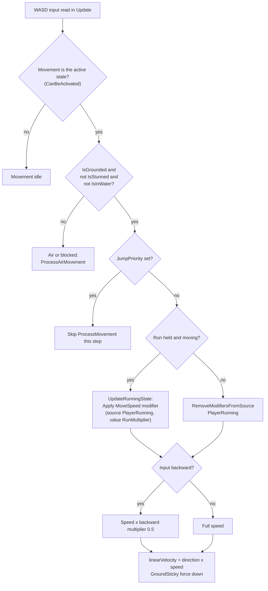

Notes:

- The run modifier is a stat change, not only a flag. Releasing run removes it.
- `Movement.FixedUpdate` and `PlayerController.FixedUpdate` both call `ProcessMovement` (finding F1).
- `IsStunned` and `IsInWater` have no writers in the code traced, so those branches never fire (finding F10).

## 3. Look (mouse)

Source: `PlayerController.OnLook` → `CameraController.Update`.

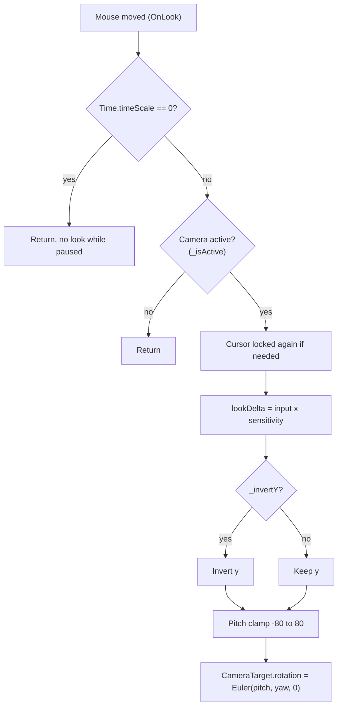

## 4. Attack (MainHand)

Source: `PlayerController.OnAttack` → `CombatStateController.HandleAttackInput`.

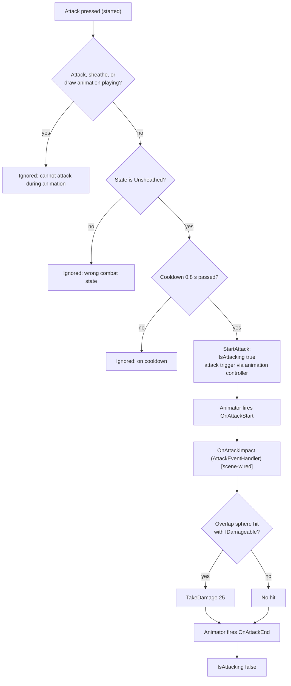

Notes:

- `IDamageable` has no implementers in the code traced, so the hit branch cannot damage anything yet (finding F9).

## 5. Toggle weapon (ToggleWeapon)

Source: `PlayerController.OnToggleWeapon` → `CombatStateController.ToggleWeaponState`.

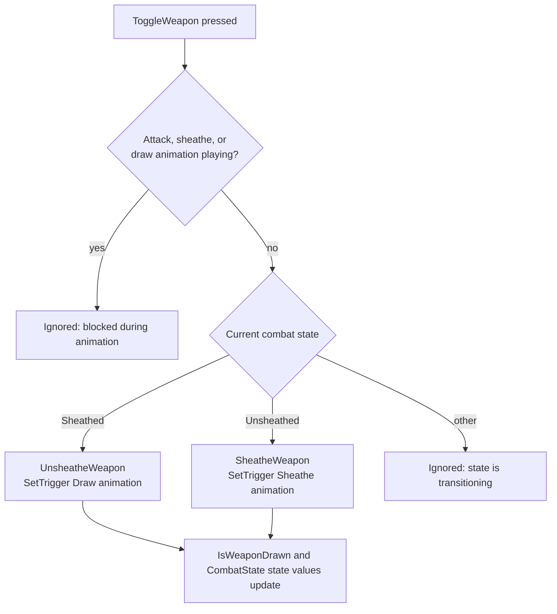

Notes:

- When movement changes to another state, `CombatStateController.OnDeactivate` force-sheathes the weapon `[verified]`.

## 6. Talent allocate (left click on a node)

Source: `TalentTreeController.OnNodeClicked` (button 0) → `TryAllocate`.

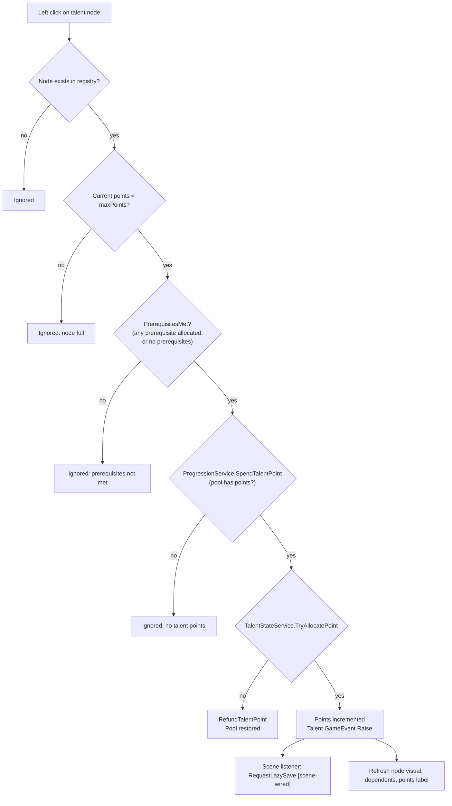

## 7. Talent remove (right click on a node)

Source: `TalentTreeController.OnNodeClicked` (button 1) → `TryRemove`.

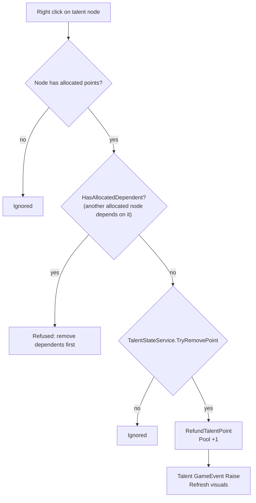

## 8. Talent panel (K)

Source: `UIInputController.OnOpenTalentWheel` → `UIManager.TogglePanel("talent-wheel-root")`.

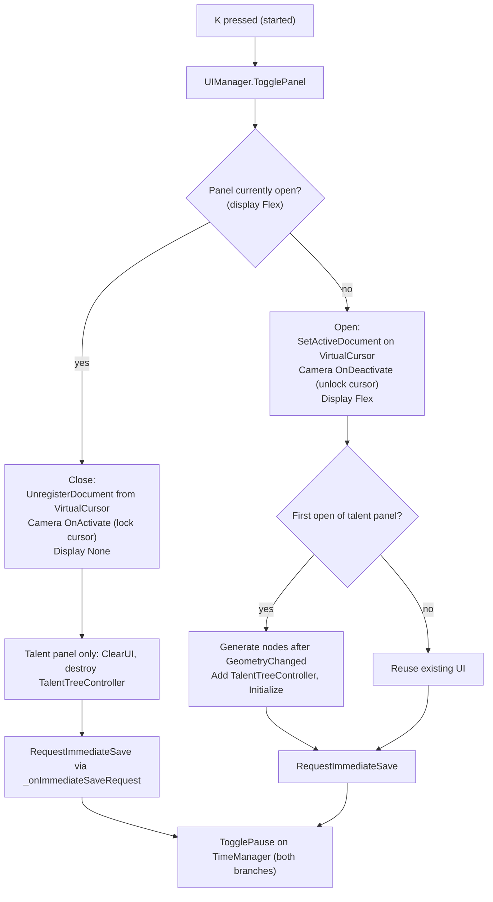

## 9. UI cursor and clicks

Source: `VirtualCursorController.Update` → `VirtualCursor.Update` → `UpdatePosition` and `HandleClicks`.

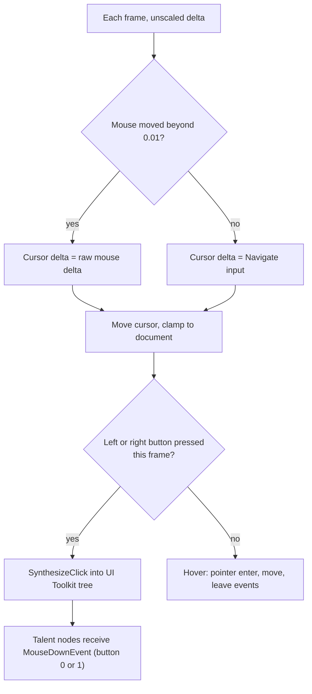

## 10. Gravity trigger

Source: `Modifier_GravityMultiplierTrigger.OnTriggerEnter` and `OnTriggerExit`.

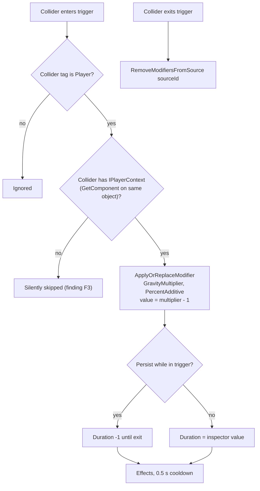

## 11. Gravity zone

Source: `Modifier_GravityDirectionZone.OnTriggerEnter` and `OnTriggerExit`. The trigger methods and the custom-direction setter (`GravityController.SetGravityScale`) are verified. The zone's configured values were not traced, so its exact effect is `[incomplete]`.

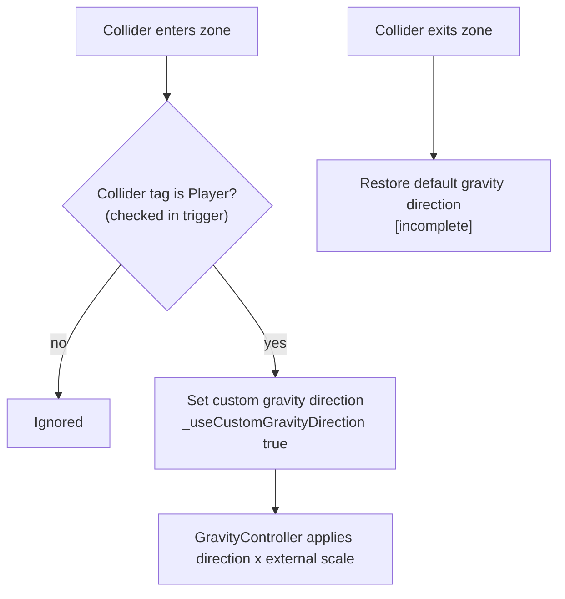

## 12. Speed boost

Source: `Modifier_MovementSpeedBoost.OnTriggerEnter`.

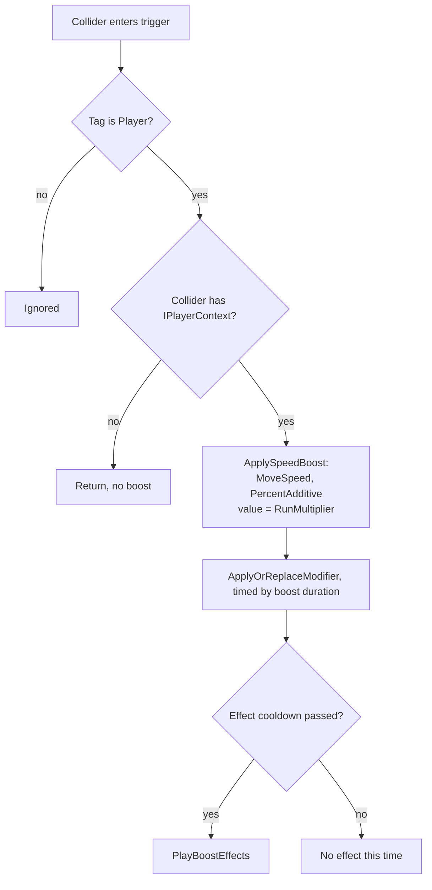

## 13. Attribute spend and refund

Source: `ProgressionService.TrySpendAttributePoint` and `TryRefundAttributePoint` (`Assets/_Project/Scripts/ProgressionService.cs`).

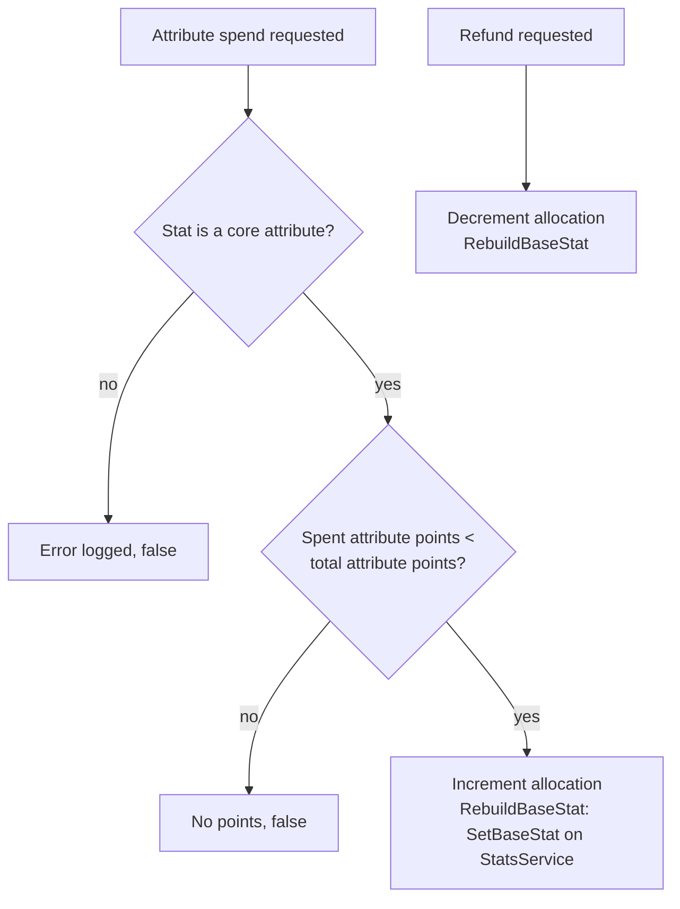

Status: no caller of either method exists in the code traced. The UI for this choice is not built yet, so this tree is unreachable from code today (finding F7).

## 14. Talent reset

Source: `TalentTreeController` reset method. No caller in code, so it is reachable only from a scene button or Inspector action `[scene-wired]`.

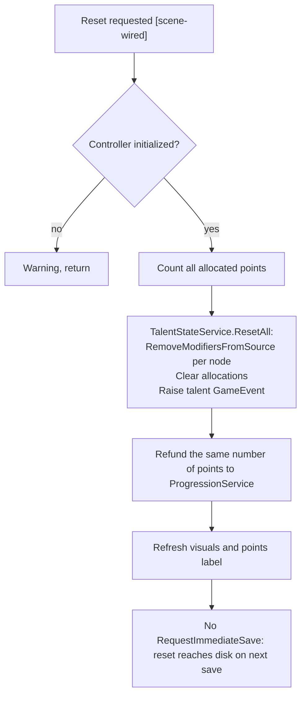

## 15. Save triggers

Source: `SaveManager.RequestLazySave`, `RequestImmediateSave`, `PerformSave`.

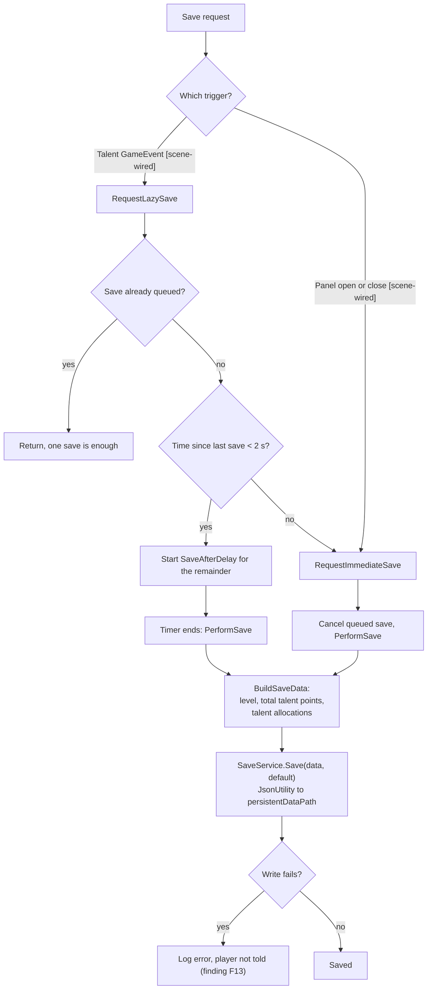

## 16. Game start

Source: `GameInitializer.Start`.

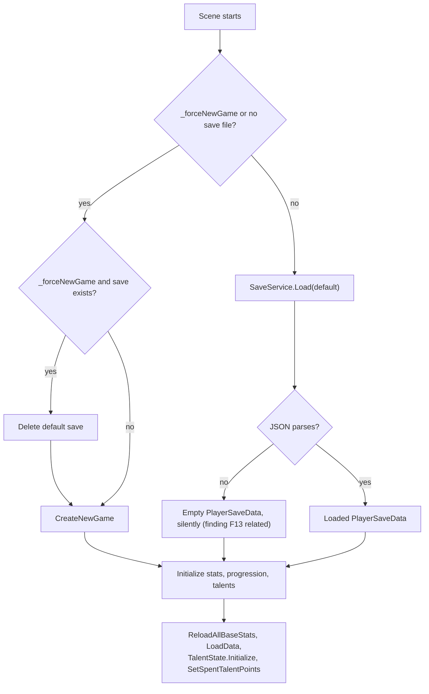

- `AttackEventHandler` is reachable only if a scene wires it up `[scene-wired]`.
