# Sol: Functional Flow Map

Every player input, player choice, and system that connects through them, traced from source. Companion to `ARCHITECTURE.md` (structure) and `diagrams/master.svg` (poster view).

**Confidence tags**

- `[verified]`: the call chain was read in source and the method names were grepped.
- `[scene-wired]`: the link is set in a Unity scene or prefab, not in code. Checked only where stated.
- `[incomplete]`: not traced in full. Reasons are given inline.

**Scope**

This is a documentation pass. Nothing here was run in the Unity Editor, so execution order and runtime results are inferred. Problems are recorded in section 9 and not fixed.

## 1. Input map

Source: `Assets/_Project/Systems/PlayerInput.inputactions`.

| Action map | Action | Binding | Handler | Effect |
|---|---|---|---|---|
| Main | Move | WASD (2DVector composite) | `PlayerController.OnMove` | Stores move vector, sets `_moveInputDetected` |
| Main | Look | Mouse delta `[scene-wired]` | `PlayerController.OnLook` | Stores look vector, read by `CameraController.Update` |
| Main | Run | Shift `[scene-wired]` | `PlayerController.OnRun` | Sets `_runInputDetected`, state `IsRunning` |
| Main | Jump | `<Keyboard>/space` | `PlayerController.OnJump` | Calls `Jumping.HandleJumpInput` |
| Main | ToggleWeapon | `[scene-wired]` | `PlayerController.OnToggleWeapon` | Calls `CombatStateController.ToggleWeaponState` |
| Main | MainHand (attack) | mouse button `[scene-wired]` | `PlayerController.OnAttack` | Calls `CombatStateController.HandleAttackInput` |
| UI | OpenTalentPanel | `<Keyboard>/k` | `UIInputController.OnOpenTalentWheel` | Calls `UIManager.TogglePanel("talent-wheel-root")` |
| UI | CursorMove | `<Mouse>/delta` | `VirtualCursorController` via `CursorInputActionMap` | Moves virtual cursor |
| UI | Left Click | `<Mouse>/leftButton` | `CursorInputActionMap` (polled) | Synthesized UI click |
| UI | Right Click | `<Mouse>/rightButton` | `CursorInputActionMap` (polled) | Synthesized UI secondary click |

The `.inputactions` file defines the bindings marked above. Rows marked `[scene-wired]` have no binding path in that file, so the exact key or button is set in the scene and was not confirmed. The scene `Persistant Scene.unity` binds these methods: `OnMove`, `OnLook`, `OnRun`, `OnJump`, `OnToggleWeapon`, `OnAttack`, `OnOpenTalentWheel`.

## 2. Master flow

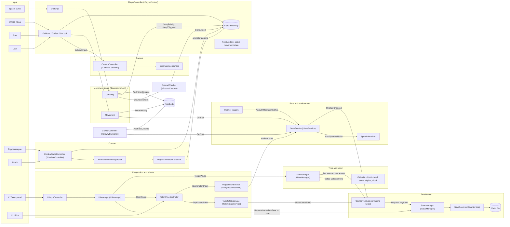

## 3. Player input flows

### 3.1 Jump (Space) `[verified]`

Chain: `<Keyboard>/space` → `PlayerController.OnJump` → `Jumping.HandleJumpInput`.

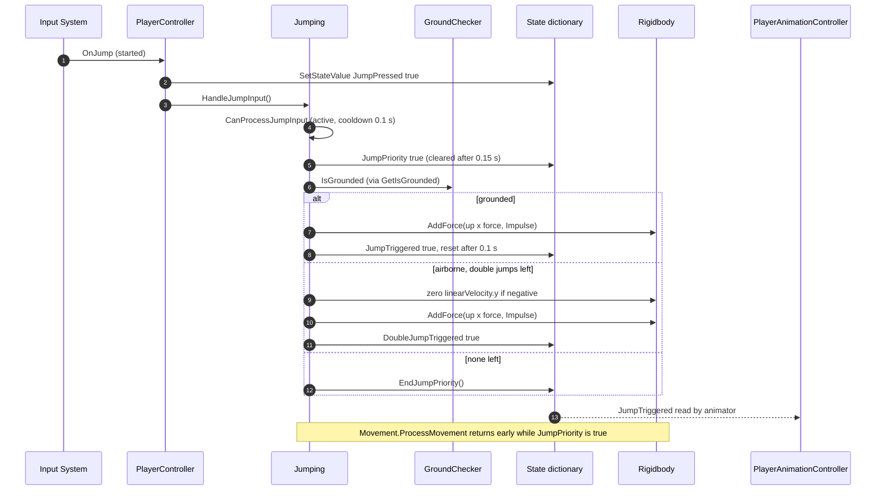

- `Jumping.OnCollisionEnter` resets the double-jump counter when a contact normal has `y > 0.7`.
- Air time is handled by `Movement.ProcessAirMovement`, which reduces horizontal speed with `_airDeceleration` (0.5).

### 3.2 Move and run (WASD, Shift) `[verified]`

Chain: `OnMove` / `OnRun` → state values → `Movement.Update` (direction) → `Movement.FixedUpdate` → `Rigidbody`.

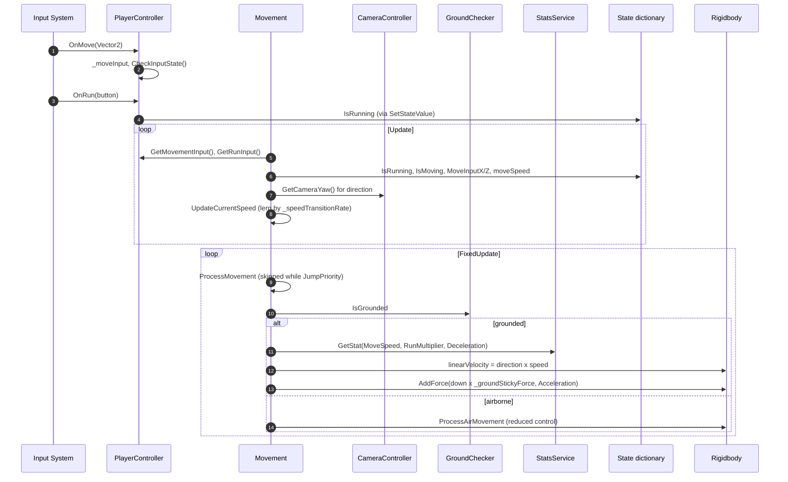

- Run is a stat-driven choice, not only an input flag. `Movement.UpdateRunningState` applies a `MoveSpeed` modifier (`PercentAdditive`, value = `RunMultiplier`, duration -1, source `PlayerRunning`) while run is held and moving. Releasing run or stopping calls `RemoveModifiersFromSource("PlayerRunning")` `[verified]`. This is the same modifier mechanism used by the environmental speed boost (section 5.3).
- `Movement.CanBeActivated` requires grounded, not stunned (`IsStunned`), and not in water (`IsInWater`). No writer for either flag was found in the code traced, so they stay `false` `[incomplete]`.
- Backward movement is scaled by `_backwardSpeedMultiplier` (0.5) and sideways movement uses `CalculateStrafingDirection`.
- `Movement.FixedUpdate` also calls `ProcessMovement`, and `PlayerController.FixedUpdate` calls the active state's `ProcessMovement`. See finding F1.

### 3.3 Look (mouse) `[verified]`

Chain: `OnLook` → `PlayerController._lookInput` → `CameraController.Update`.

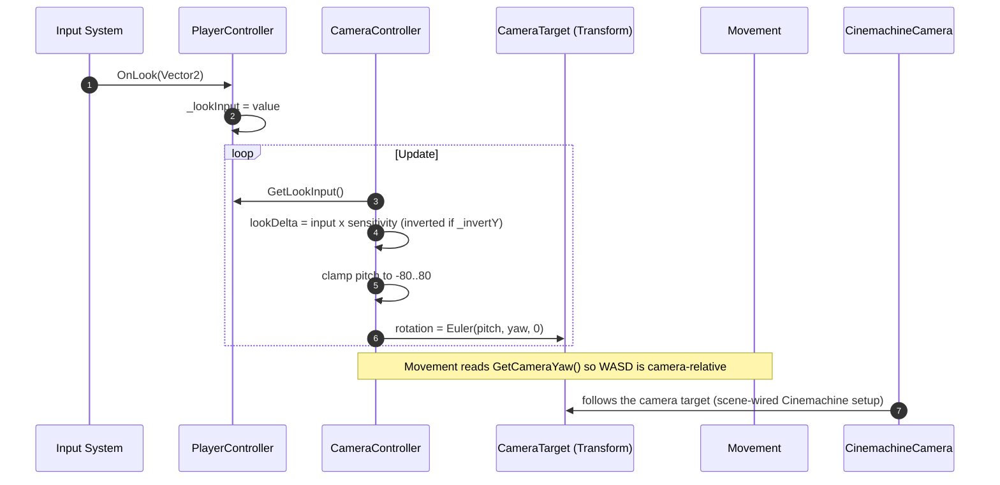

- `CameraController.Update` returns early when `Time.timeScale == 0`, so look input stops while the game is paused `[verified]`.
- `CameraController.OnDeactivate` unlocks the cursor. `OnActivate` locks it. `UIManager.OpenPanel` deactivates the camera, which is why the talent panel stops mouse-look.

### 3.4 Weapon toggle and attack (ToggleWeapon, MainHand) `[verified]` with `[incomplete]` animation timing

Chain: `PlayerController.OnToggleWeapon` / `OnAttack` → `CombatStateController` → animation events → state values.

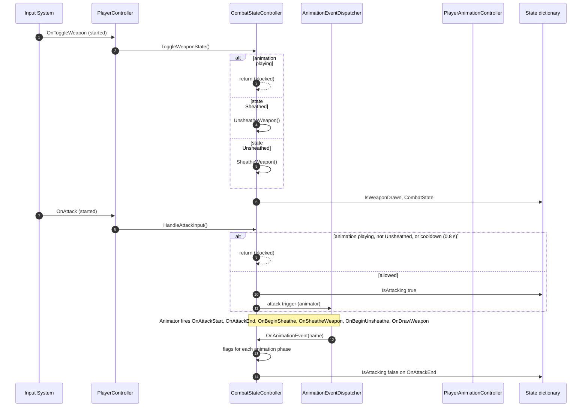

- `CombatStateController` registers as an `IAnimationEventReceiver`, and `AnimationEventDispatcher` routes by event name `[verified]`.
- Damage and enemy hit logic are not in this path. `IDamageable` has no implementers in the code traced, so combat results are `[incomplete]`.
- `CombatStateController.OnDeactivate` force-sheathes the weapon when movement changes to another state `[verified]`.

## 4. Player choices: talents, attributes, and progression

### 4.1 Talent allocate and remove (LMB on a talent node) `[verified]` with `[scene-wired]` save link

Chain: `TalentTreeController.OnNodeClicked` → `ProgressionService.SpendTalentPoint` (pool) → `TalentStateService.TryAllocatePoint` (rules) → talent `GameEvent` → `GameEventListener` → `SaveManager`.

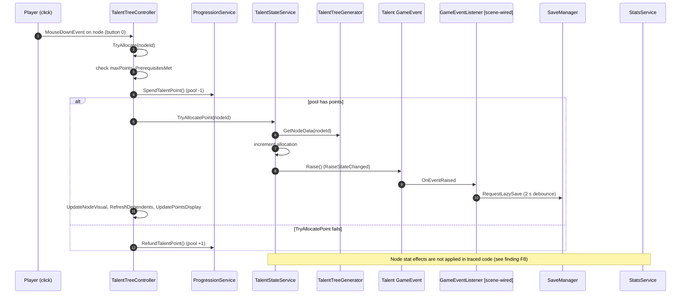

Remove (RMB on a node) runs `TalentTreeController.TryRemove`. It is refused when another allocated node depends on this one (`HasAllocatedDependent`). If allowed, it calls `TalentStateService.TryRemovePoint`, then `ProgressionService.RefundTalentPoint`.

- Talent allocation spends the progression pool first. A failed state allocation refunds it. This order is the one in the code `[verified]`.
- `TalentStateService` gets its dependencies through its constructor, not the `ServiceLocator` `[verified]`.
- Save wiring: the scene binds `SaveManager.RequestLazySave` and `RequestImmediateSave` `[scene-wired]`. The talent `GameEvent`'s listener is not in code, so the listener binding was not confirmed `[scene-wired]`.

### 4.2 Talent panel open and close (K) `[verified]`

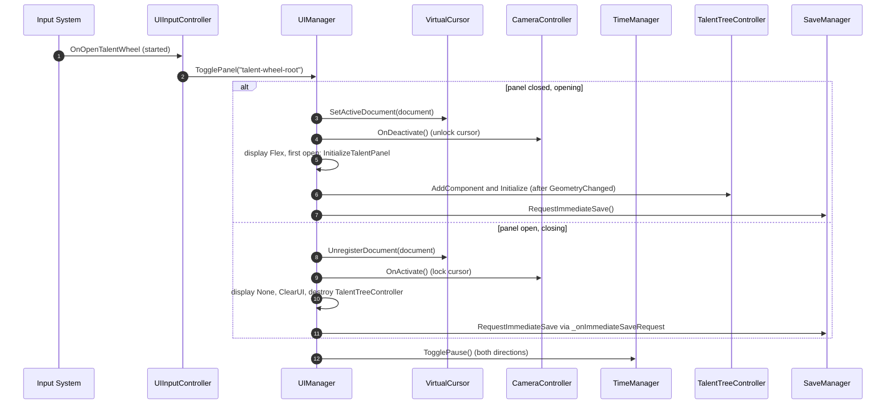

- `UIManager.InitializeTalentPanel` requests an immediate save when the panel opens, so the spend state is written before play continues `[verified]`.
- `UIManager.ClosePanel` raises `_onImmediateSaveRequest`. The scene wires this event to `SaveManager` `[scene-wired]`.
- Opening and closing both call `TogglePause`, so time stops while the panel is open `[verified]`.

### 4.3 Attribute spend and refund (`ProgressionService`) `[verified]` with `[incomplete]` UI

`ProgressionService.TrySpendAttributePoint(statType)` and `TryRefundAttributePoint(statType)` change `_attributeAllocations` and call `RebuildBaseStat`, which sets the base stat on `StatsService` to default + allocated `[verified]`.

No UI caller of `TrySpendAttributePoint` or `TryRefundAttributePoint` was found in the code traced. The attribute-allocation UI is `[incomplete]`. The stat is still rebuilt on load through `ReloadAllBaseStats()`, which `GameInitializer.Start` calls.

### 4.4 Stat changes from talents and environment `[verified]`

- `StatsService.ApplyOrReplaceModifier` and `ApplyModifier` store a `StatModifier` under its `sourceId` and `modifierId`. Each change marks the cache dirty and raises `OnStatsChanged` `[verified]`.
- `StatsService.RemoveModifiersFromSource(sourceId)` removes everything from one source. `TalentStateService.ResetAll` calls it per node ID before clearing `[verified]`.
- `GetStat` reads the cache and recomputes when dirty `[verified]`.

## 5. Environment, stats, and world reactions

### 5.1 Gravity trigger (`Modifier_GravityMultiplierTrigger`) `[verified]`

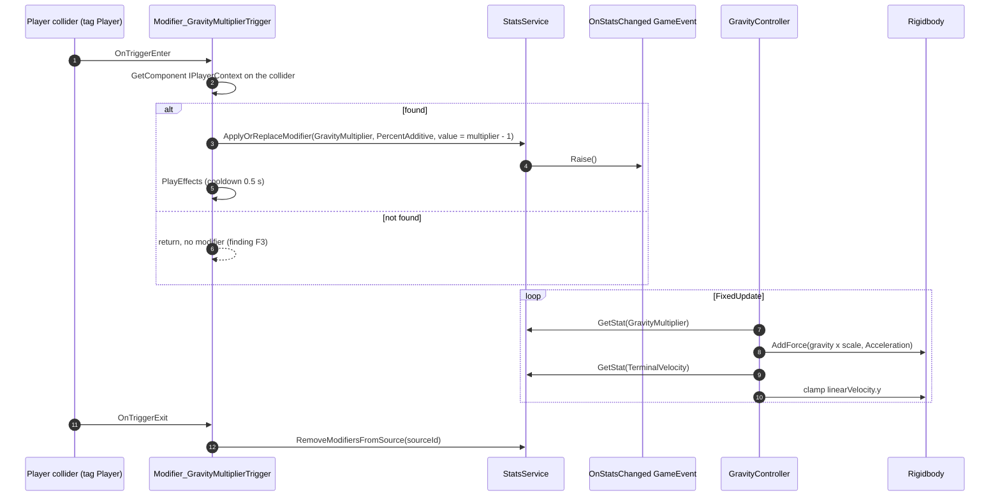

- `_persistWhileInTrigger` makes the modifier permanent (duration -1) until exit `[verified]`.
- `GravityController` sets `Rigidbody.useGravity = false`, so all gravity comes from its own force `[verified]`.

### 5.2 Gravity zone (`Modifier_GravityDirectionZone`) `[verified]`

Same shape as 5.1, but it sets a custom gravity direction through `IGravityController.SetGravityScale` and `_useCustomGravityDirection` in `GravityController.ProcessGravity` `[verified]`. Its trigger tag and handler were not traced in detail `[incomplete]`.

### 5.3 Speed boost (`Modifier_MovementSpeedBoost`) `[verified]`

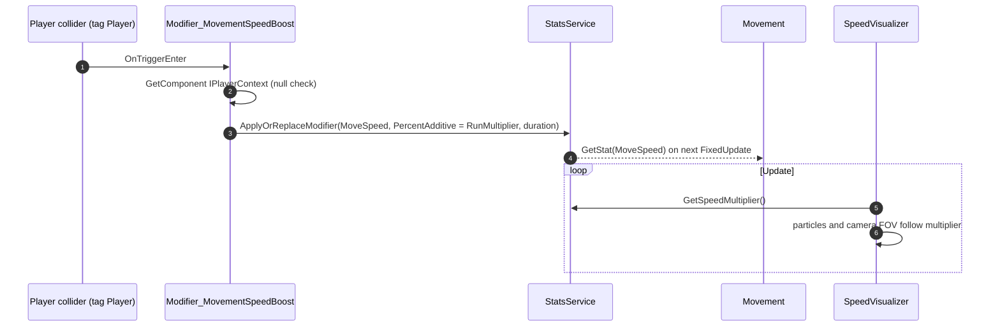

- The boost value is taken from `RunMultiplier`, not from the inspector's `_speedBoostAmount` (the code that used it is commented out) `[verified]`.
- `SpeedVisualizer` finds its `IStatsService` through `IPlayerContext.GetService` in `Start` `[verified]`.

### 5.4 Rotating props (`Rotator`) `[verified]`

`Rotator.Update` rotates its transform by `rotationSpeed` on the selected axes, and can face the camera (`faceCamera`). It has an optional throttled update (`useOptimization`, `updateFrequency`) `[verified]`. It is not connected to player state.

## 6. World and time (continued)

### 6.1 Time events and polled values `[verified]`

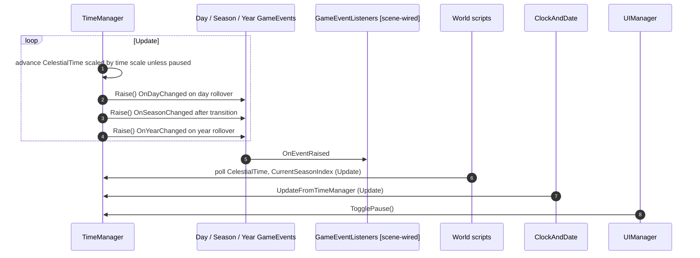

- `TimeManager` raises events on day, season, and year changes `[verified]`. Continuous values such as `CelestialTime` are polled `[verified]`.
- `ClockAndDate` writes its text from `TimeManager` each update `[verified]`.

### 6.2 World effects

| Script | Reads | Effect | Status |
|---|---|---|---|
| `CelestialRotator` | `ITimeManager`, `ICelestialCalculator` | Sun and moon transform | `[verified]` |
| `SkyboxRotator` | `SkyAndFogController` (on same object) | Skybox rotation | `[verified]` |
| `SkyAndFogController` | HDRP `Volume` (inspector) | Sky and fog profile | `[verified]` for the call path, `[incomplete]` for profile values |
| `CloudController` | `ITimeManager`, wind | Cloud density and direction | `[verified]` |
| `WindController` | `WindZone` on same object | Wind strength | `[verified]` |
| `SnowCoverController` | none active | Snow material | `[incomplete]` (main logic is commented out) |
| `SeasonalData`, `WeatherData`, `WorldTimeData` | scriptable objects | Season and weather values | `[verified]` as data, `[incomplete]` for the weather runtime (`WeatherManager` is fully commented out) |

### 6.3 Virtual cursor and UI pointer path `[verified]`

`VirtualCursorController.Awake` builds `CursorInputActionMap` from the `UI` action map and registers `IVirtualCursor` `[verified]`. Each `Update` calls `VirtualCursor.Update(unscaledDeltaTime)` so it keeps working while the game is paused `[verified]`.

- `VirtualCursor.UpdatePosition` moves the cursor from `GetMovementDelta` (mouse delta when the mouse moves, otherwise navigation input) `[verified]`.
- `HandleRaycastAndEvents` and `SynthesizeClick` send pointer events into the UI Toolkit tree `[verified]`. `TalentTreeController` uses `MouseDownEvent` on nodes, so the synthesized click reaches the talent nodes `[verified]`.
- `VirtualCursor.SetActiveDocument` and `UnregisterDocument` are called by `UIManager` when the panel opens and closes `[verified]`.

## 7. Save, load, and progression data

### 6.1 Save data shape `[verified]`

Source: `Player/PlayerSaveData.cs`. Serialized with `JsonUtility` through `SaveService`.

| Field group | Fields | Written by | Read by |
|---|---|---|---|
| Progression | `level`, `totalTalentPoints`, `prestigePoints`, `totalAttributePoints` | `SaveManager.BuildSaveData` (level, talent points) | `GameInitializer.Start` → `ProgressionService.Initialize` |
| Talents | `talentAllocations[]` (`nodeId`, `allocatedPoints`) | `SaveManager.BuildSaveData` from `TalentStateService.GetAllocatedNodeIds` | `TalentStateService.Initialize` |
| Attributes | `attributeAllocations[]` (`statType`, `pointsAllocated`) | Not written by `BuildSaveData` `[incomplete]` | `ProgressionService.Initialize` |
| Vitals | `currentHealth`, `currentEnergy` | Not written by `BuildSaveData` `[incomplete]` | Not read in code traced |
| Equipment and inventory | `equipped*Id` fields, `inventoryInstanceIds` | Not written `[incomplete]` | Not read `[incomplete]` |

Note the gap: `SaveManager.BuildSaveData` writes only level, total talent points, and talent allocations. Attribute allocations, vitals, and equipment are part of the save format but are not saved during play `[verified]`. A save therefore loses those values unless another writer exists, which was not found.

### 6.2 Load and new game (`GameInitializer`) `[verified]`

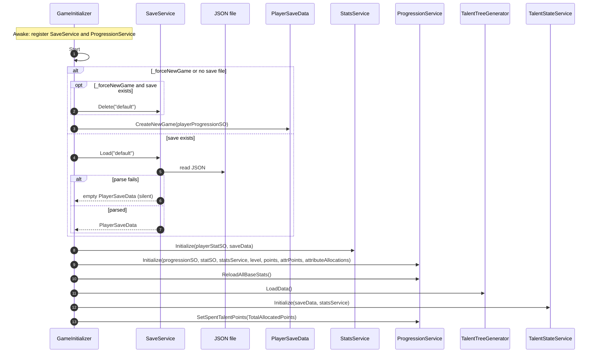

### 6.3 Save write path `[verified]` with `[scene-wired]` triggers

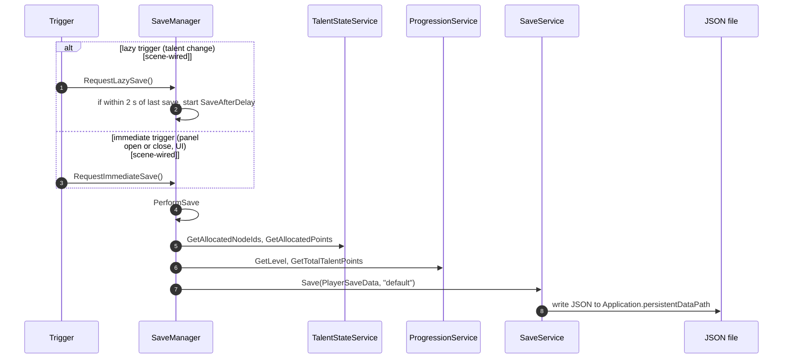

- `SaveManager.RequestLazySave` returns early when a save is already queued, and runs `RequestImmediateSave` when the debounce interval has passed `[verified]`.
- `SaveService.Save` logs and swallows write errors (`Failed to save`) `[verified]`. The player is not told.
- `SaveService.Delete` is called on a forced new game and by `DeleteSaveDebug` `[verified]`.

### 6.4 Reset (talent reset) `[verified]` with `[scene-wired]` caller

`TalentTreeController` reset: count allocated points, `TalentStateService.ResetAll()` (which removes stat modifiers by node ID), refund the same number of points to `ProgressionService`, refresh the visuals `[verified]`. The method has no code caller, so it is reachable only from a scene button or Inspector action `[scene-wired]`. The reset does not call `RequestImmediateSave`, so the reset state reaches disk only on the next save trigger `[verified]`.

## 8. Failure and edge cases

| Situation | What the code does | Status |
|---|---|---|
| Jump pressed during cooldown (0.1 s) | Ignored | `[verified]` |
| Jump pressed with no jump left | Priority cleared, no force | `[verified]` |
| Attack during an attack, sheathe, or draw animation | Ignored | `[verified]` |
| Attack during cooldown (0.8 s) | Ignored | `[verified]` |
| Toggle weapon during an animation | Ignored | `[verified]` |
| Talent click with no pool points | `SpendTalentPoint` returns false, nothing changes | `[verified]` |
| Talent click with unmet prerequisite | `PrerequisitesMet` returns false, nothing changes | `[verified]` |
| Remove talent that has an allocated dependent | Refused | `[verified]` |
| Save file unreadable | Empty `PlayerSaveData` used | `[verified]` |
| Save write fails | Error logged, player not told | `[verified]` |
| Service not registered | `ServiceLocator.Get` returns null and logs an error | `[verified]` |
| Ground-stuck or water states | `IsInWater` and `IsStunned` never set in code traced | `[incomplete]` |

## 9. Known issues and findings

Documented only. None were fixed. "Needs editor check" items depend on Unity execution order or scene state.

| ID | Area | Finding | Evidence | Status |
|---|---|---|---|---|
| F1 | Movement | `Movement.FixedUpdate` calls `ProcessMovement()`, and `PlayerController.FixedUpdate` also calls the active state's `ProcessMovement()`. If `Movement` is active, it may run twice per physics step. | `Movement.cs` FixedUpdate, `PlayerController.cs` FixedUpdate | Needs editor check |
| F2 | Physics | Four components write to one Rigidbody: `Jumping`, `Movement`, `GravityController`, and `PlayerController.ApplyMovement`. Final velocity depends on order. | `Jumping.cs:141,165,181`, `Movement.cs:272-341`, `GravityController.cs:87,96`, `PlayerController.cs:339` | Documented |
| F3 | Environment | Gravity and speed triggers call `other.GetComponent<IPlayerContext>()`, which only finds the component on the collider's own GameObject. If the collider is on a child, the modifier silently never applies. | `Modifier_GravityMultiplierTrigger.cs:44-50`, `Modifier_MovementSpeedBoost.cs` OnTriggerEnter | Needs editor check |
| F4 | Jumping | Dead coroutines: `ResetJumpTrigger` and `ResetDoubleJumpTrigger` are defined and never started. `ClearJumpPriority` duplicates `ClearJumpPriorityAfterDelay`. | `Jumping.cs:203-220` | Documented |
| F5 | Saving | `GameInitializer` comment says to wire `SaveManager.QueueSave()`, but no such method exists. The scene binds `RequestLazySave`. | `GameInitializer.cs:89` | Documented (stale comment) |
| F6 | Save data | `BuildSaveData` writes only level, total talent points, and talent allocations. Attribute allocations, vitals (`currentHealth`, `currentEnergy`), and equipment fields are never written during play. | `SaveManager.cs:74-95`, `PlayerSaveData.cs` | Documented |
| F7 | Progression | `ProgressionService.TrySpendAttributePoint` and `TryRefundAttributePoint` have no callers, so attribute spending is not reachable from the UI. | Grep across `Assets/` | Documented |
| F8 | Talents | Talent node stat effects are not applied anywhere in the code traced. `TalentStateService` tracks points and raises an event, but nothing turns an allocated node into a `StatModifier`. | `TalentStateService.cs`, grep for `ApplyModifier` callers | Needs check (may be in node data code not traced) |
| F9 | Combat | `IDamageable` has one caller (`AttackEventHandler.CheckForHits`) and no implementers in the code. Attacks cannot damage anything yet. `AttackEventHandler` has no other references, so it depends on scene wiring. | `AttackEventHandler.cs:140`, grep for `IDamageable` | Documented |
| F10 | State | `IsStunned` and `IsInWater` are read by `Movement.CanBeActivated` but never set in the code traced. | `Movement.cs:91-92` | Documented |
| F11 | Gravity | `GravityController` keeps an internal gravity scale and uses it when falling, while the stats `GravityMultiplier` is applied on top. Comments say stats are not involved in that decision. | `GravityController.cs:25-26,76-82` | Documented |
| F12 | Reset | Talent reset refunds the pool and calls `ResetAll`, but does not request a save. Reset state persists only on the next save trigger. | `TalentTreeController.cs` reset method | Documented |
| F13 | Saving | `SaveService.Save` logs write failures and does not notify the player. | `SaveService.cs:50-63` | Documented |
| F14 | Weather | `WeatherManager.cs` and `SnowCoverController` main logic are commented out, so weather and snow do not run. | File contents | Documented |

## 10. Validation

- Method and class names were checked with grep against source. Callers of `IDamageable`, `TrySpendAttributePoint`, `TryRefundAttributePoint`, `ResetAll`, `SetStateValue("IsInWater")`, and `SetStateValue("IsStunned")` were checked. The results support F7, F8, F9, and F10 as written.
- Scene bindings were checked by grepping `Persistant Scene.unity` for `m_MethodName`. Other scenes were not checked.
- All Mermaid blocks in this file were rendered with `@mermaid-js/mermaid-cli@11` and a headless Chrome shell. Each rendered with exit 0 and no error text in the log.

## 11. Not covered in depth

- Weapon data and visuals (`WeaponDataSO`, `WeaponRigController`, `WeaponVisualManager`, `ActiveEquipment`).
- Inventory and equipment runtime.
- Talent node data and the layout generator (`TalentTreeGenerator`, `RadialTreeGenerator`, `TreeLayoutSO`).
- Tooltip system and the full UI Toolkit layout.
- Scene-specific listeners, UnityEvents, and trigger colliders beyond `Persistant Scene.unity`.
- Enemy behavior beyond the `IDamageable` interface.
