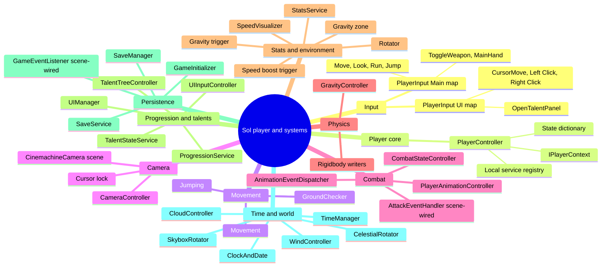

# Sol: Mind Map

Overview of every system and how the systems connect. Companion to `../FLOWS.md` (full sequences) and `../DECISION_TREES.md` (checks per input).

Mind maps cannot show edges, so cross-system links are listed in the table below the map.

## Cross-system links

| From | To | Mechanism | Source |
|---|---|---|---|
| Input (Space) | Jumping | `PlayerController.OnJump` calls `HandleJumpInput` | `PlayerController.cs` |
| Input (WASD, Shift) | Movement, state dictionary | `OnMove`, `OnRun` set state and input | `PlayerController.cs` |
| Input (mouse) | CameraController | `GetLookInput` | `CameraController.cs` |
| Input (K) | UIManager | `UIInputController.OnOpenTalentWheel` calls `TogglePanel` | `UIInputController.cs` |
| Input (attack, toggle) | CombatStateController | `HandleAttackInput`, `ToggleWeaponState` | `PlayerController.cs` |
| Jumping, Movement | Rigidbody | `AddForce`, `linearVelocity` | `Jumping.cs`, `Movement.cs` |
| GroundChecker | State dictionary | `SetStateValue("IsGrounded")` | `GroundChecker.cs` |
| Movement | StatsService | `GetStat(MoveSpeed)`, run modifier | `Movement.cs` |
| GravityController | StatsService | `GetStat(GravityMultiplier, TerminalVelocity)` | `GravityController.cs` |
| Gravity and speed triggers | StatsService | `ApplyOrReplaceModifier`, `RemoveModifiersFromSource` | `Modifier_*.cs` |
| StatsService | SpeedVisualizer | `GetSpeedMultiplier` | `SpeedVisualizer.cs` |
| StatsService | GameEvent listeners | `OnStatsChanged` raise | `StatsService.cs` |
| TalentTreeController | ProgressionService | `SpendTalentPoint`, `RefundTalentPoint` | `TalentTreeController.cs` |
| TalentTreeController | TalentStateService | `TryAllocatePoint`, `TryRemovePoint`, `ResetAll` | `TalentTreeController.cs` |
| TalentStateService | Save listener | talent `GameEvent.Raise` (listener is scene-wired) | `TalentStateService.cs` |
| UIManager | TimeManager | `TogglePause` on open and close | `UIManager.cs` |
| UIManager | CameraController | `OnDeactivate` on open, `OnActivate` on close | `UIManager.cs` |
| UIManager | SaveManager | `RequestImmediateSave` on open and close | `UIManager.cs` |
| TimeManager | Save listener and world | day, season, year events; polled `CelestialTime` | `TimeManager.cs` |
| GameInitializer | Services | `Initialize` for stats, progression, talents | `GameInitializer.cs` |

Scene-wired links are not in code. They were checked in `Persistant Scene.unity` only, for the save and UI bindings.
